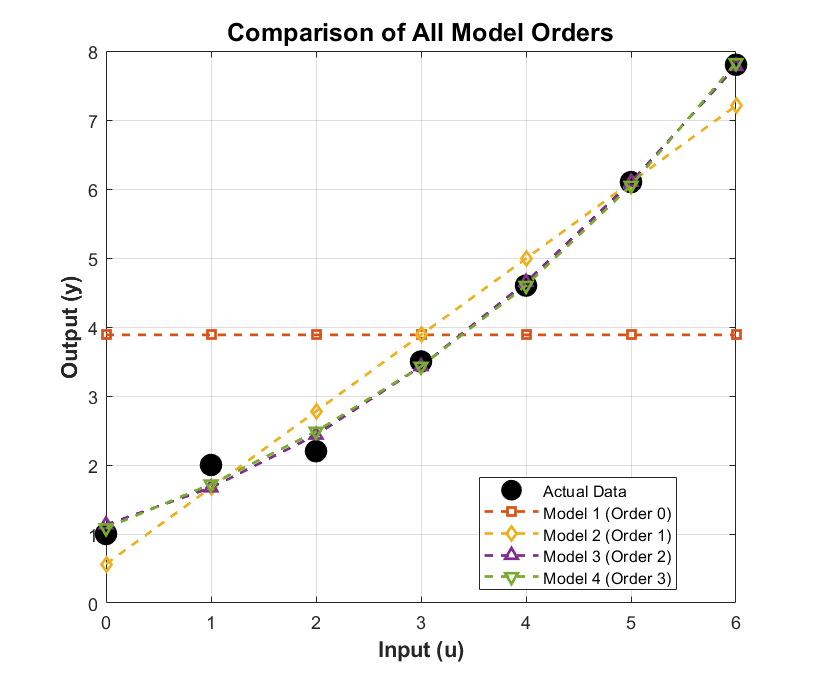

# Adaptive Control: Least-squares parameter estimation

Åström & Wittenmark example 2.1: polynomial models of order 0 to 3 fitted by least squares, and the loss compared.

## Files

- [`report_en.pdf`](report_en.pdf): English summary (LaTeX source next to it)
- `main.m`
- `figures/`: plots regenerated by re-running the code in MATLAB R2023b

## How to run

Run `main.m`.
