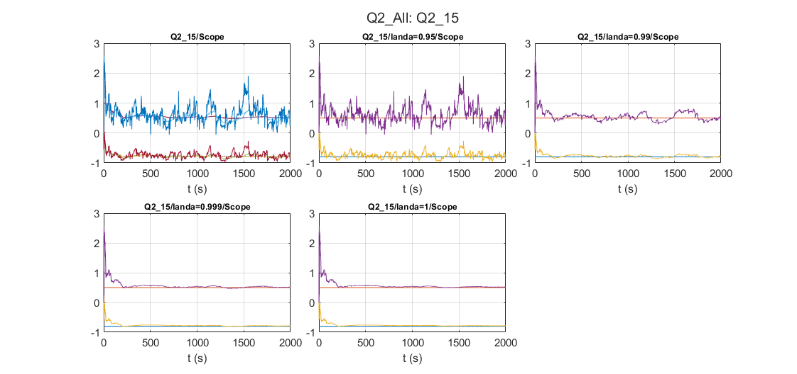

# Adaptive Control: Recursive least squares, excitation and forgetting

Åström & Wittenmark simulations 2.12-2.15: how input excitation and the forgetting factor affect RLS estimates.

## Files

- [`report_en.pdf`](report_en.pdf): English summary (LaTeX source next to it)
- [`report_fa.pdf`](report_fa.pdf): my original report in Persian
- `Q2_All.slx`
- `figures/`: plots regenerated by re-running the code in MATLAB R2023b

## How to run

Run `Q2_All.slx` (one subsystem per simulation).
