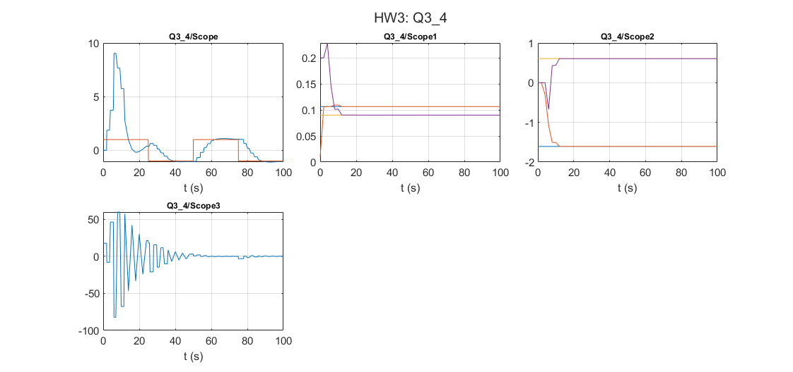

# Adaptive Control: Indirect self-tuning regulators

Åström & Wittenmark examples 3.4-3.6: RLS plus pole placement, with and without cancelling the process zero, and in continuous time.

## Files

- [`report_en.pdf`](report_en.pdf): English summary (LaTeX source next to it)
- [`report_fa.pdf`](report_fa.pdf): my original report in Persian
- `HW3.slx`
- `figures/`: plots regenerated by re-running the code in MATLAB R2023b

## How to run

Run `HW3.slx`.
