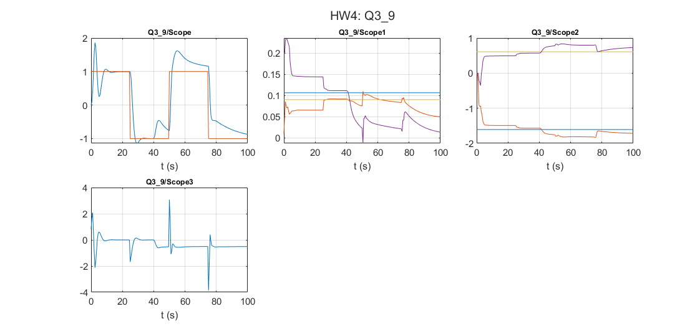

# Adaptive Control: Self-tuning regulators under disturbances

Åström & Wittenmark examples 3.9-3.10: a standard STR, an STR with filtered regressors, and an STR with a disturbance model.

## Files

- [`report_en.pdf`](report_en.pdf): English summary (LaTeX source next to it)
- `HW4.slx`
- `figures/`: plots regenerated by re-running the code in MATLAB R2023b

## How to run

Run `HW4.slx`.
