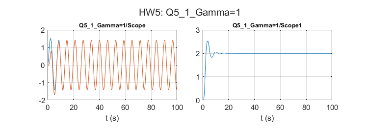

# Adaptive Control: Model-reference adaptive systems

Åström & Wittenmark examples 5.1, 5.2 and 5.7: MIT-rule and Lyapunov-based MRAS, each for three adaptation gains.

## Files

- [`report_en.pdf`](report_en.pdf): English summary (LaTeX source next to it)
- `HW5.slx`
- `figures/`: plots regenerated by re-running the code in MATLAB R2023b

## How to run

Run `HW5.slx`.
