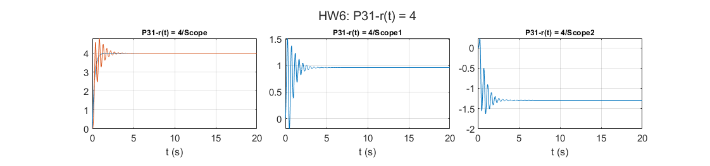

# Adaptive Control: Lyapunov-based MRAC of an unstable plant

Lecture examples: adaptive state and reference gains for an unstable first-order plant, with constant and sinusoidal references, plus a version with an extra adapted parameter.

## Files

- [`report_en.pdf`](report_en.pdf): English summary (LaTeX source next to it)
- [`report_fa.pdf`](report_fa.pdf): my original report in Persian
- `HW6.slx`
- `figures/`: plots regenerated by re-running the code in MATLAB R2023b

## How to run

Run `HW6.slx`.
