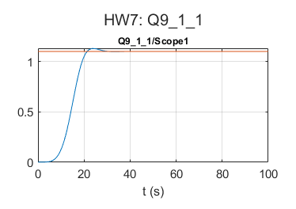

# Adaptive Control: Compensating a nonlinear valve

Åström & Wittenmark example 9.1: a loop with a nonlinear valve, compensated by a piecewise-linear approximate inverse of the valve characteristic.

## Files

- [`report_en.pdf`](report_en.pdf): English summary (LaTeX source next to it)
- [`report_fa.pdf`](report_fa.pdf): my original report in Persian
- `HW7.slx`
- `figures/`: plots regenerated by re-running the code in MATLAB R2023b

## How to run

Run `HW7.slx`.
