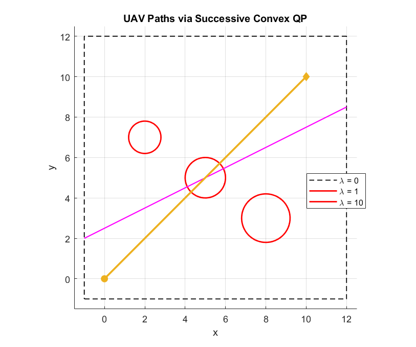

# Convex Optimization: Successive convex optimization, warehouse location, UAV path planning and an SDP

An essay question on successive convex optimization, a set-covering model for warehouse placement, UAV path planning that trades control effort against obstacle risk with an iterated QP, and a small SDP with trace constraints.

## Files

- [`report_en.pdf`](report_en.pdf): English summary (LaTeX source next to it)
- [`report_fa.pdf`](report_fa.pdf): my original report in Persian
- `Q3.m`
- `Q4.m`
- `figures/`: plots regenerated by re-running the code in MATLAB R2023b

## How to run

`Q3.m` (Optimization Toolbox). When re-run, `quadprog` reports the linearised QP as infeasible at every iteration, so the plotted paths stay on the initial straight line; this is noted, not fixed. `Q4.m` needs [CVX](https://cvxr.com/cvx/), which was not installed here.
