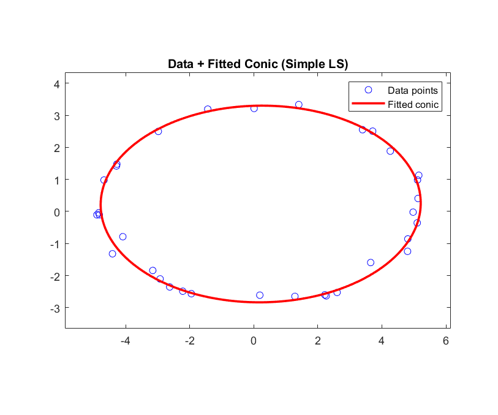

# Convex Optimization: Optimization basics, Chebyshev approximation and conic fitting

Short questions on the standard form of an optimization problem, minimax (Chebyshev) approximation as an LP, infimum versus minimum, facility location and why convexity matters. The main exercise fits a conic (an ellipse) to measured points by least squares, with one coefficient fixed to avoid the trivial solution.

## Files

- [`report_en.pdf`](report_en.pdf): English summary (LaTeX source next to it)
- `Q2.m`
- `data.mat`
- `figures/`: plots regenerated by re-running the code in MATLAB R2023b

## How to run

Run `Q2.m` (it loads `data.mat`).
