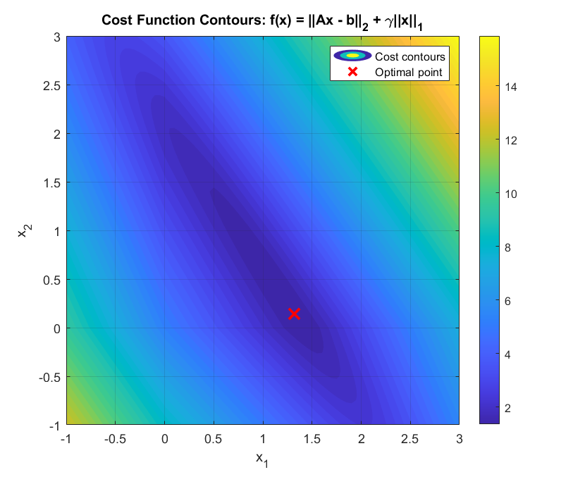

# Convex Optimization: Take-home quiz 4: LP, QP, SOCP and SDP

Deciding whether problems are convex and rewriting them in standard form: the Bellman equation as an LP, l2 + l1 regression as an SOCP, complex least squares, and a sum-of-squares SDP for bounding a polynomial.

## Files

- [`report_en.pdf`](report_en.pdf): English summary (LaTeX source next to it)
- `Quiz_Code.m`
- `figures/`: plots regenerated by re-running the code in MATLAB R2023b

## How to run

`Quiz_Code.m` (MATLAB + YALMIP) solves question 7 and draws the cost contours.
