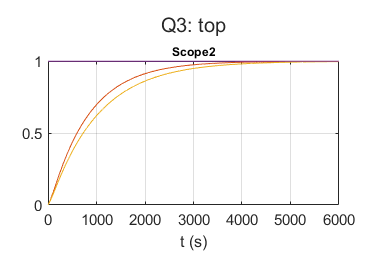

# Multivariable Control: Representations, pairing and decoupling a distillation column

Transfer function versus state space, RGA pairing, a survey of MIMO design methods, and Simulink simulations of a strongly coupled 2x2 column: open loop, independent PIDs, a dynamic decoupler, and an inverse decoupler with integral action.

## Files

- [`report_en.pdf`](report_en.pdf): English summary (LaTeX source next to it)
- [`report_fa.pdf`](report_fa.pdf): my original report in Persian
- `Q1.slx`
- `Q2.slx`
- `Q2Code.m`
- `Q3.slx`
- `Q3Code.m`
- `Q4.slx`
- `figures/`: plots regenerated by re-running the code in MATLAB R2023b

## How to run

Run `Q2Code.m` then `Q3Code.m` (PID tuning), and the models `Q1.slx` to `Q4.slx`.
