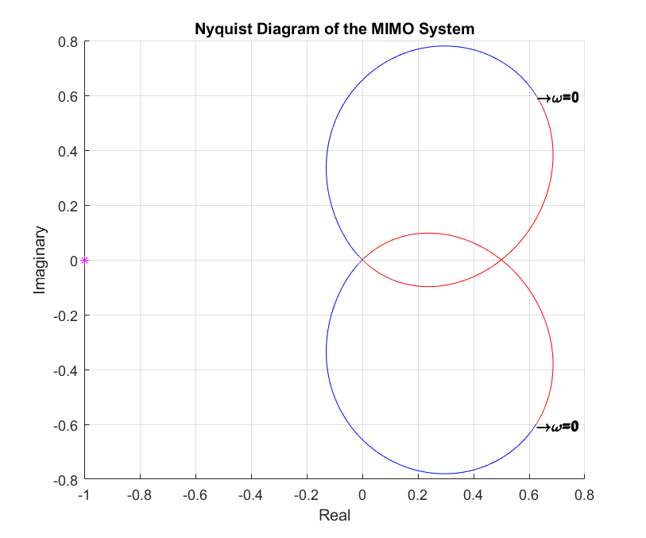

# Multivariable Control: Characteristic loci

The generalised Nyquist criterion for a 2x2 plant, with the eigenvalue loci of G(s) drawn from a symbolic computation.

## Files

- [`report_en.pdf`](report_en.pdf): English summary (LaTeX source next to it)
- `char_loci.m`
- `figures/`: plots regenerated by re-running the code in MATLAB R2023b

## How to run

Run `char_loci.m` (copied unchanged from the report).
