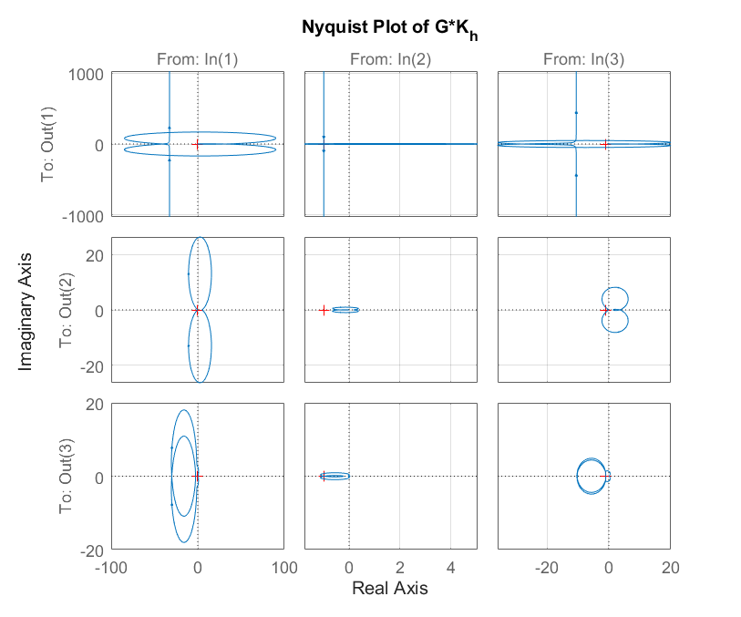

# Multivariable Control: Take-home exam: characteristic-locus design

Characteristic-locus design (ALIGN high-frequency compensator, lead, then PI) for the AIRC aircraft model and the TGEN turbo-generator model from Maciejowski.

## Files

- [`report_en.pdf`](report_en.pdf): English summary (LaTeX source next to it)
- `Q1_final.m`
- `Q2_final.m`
- `figures/`: plots regenerated by re-running the code in MATLAB R2023b

## How to run

Run `Q1_final.m` and `Q2_final.m`. Both run, but the closed loops they form are unstable when re-checked (largest pole real part +0.34 and +44.1). This is noted in the summary and the code is left as submitted.
