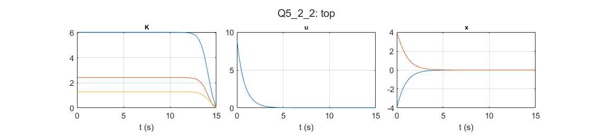

# Optimal Control: Finite-horizon LQR in Simulink

Kirk examples 5.2-1 and 5.2-2: the Riccati differential equation is integrated backwards offline, and the time-varying gain is applied in Simulink.

## Files

- [`report_en.pdf`](report_en.pdf): English summary (LaTeX source next to it)
- `Q5_2_1.slx`
- `Q5_2_2.slx`
- `Q5_2_2_Gains.m`
- `figures/`: plots regenerated by re-running the code in MATLAB R2023b

## How to run

Run `Q5_2_2_Gains.m`, then `Q5_2_2.slx`. `Q5_2_1.slx` runs on its own.
