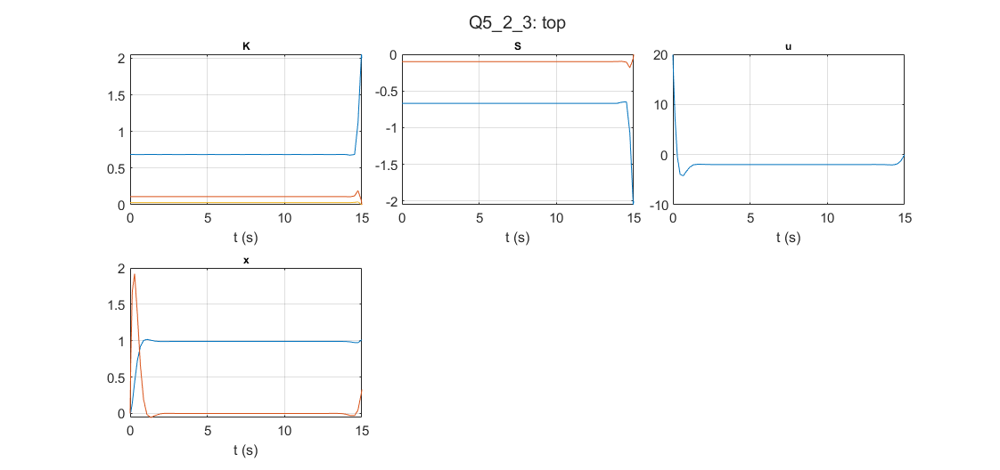

# Optimal Control: Tracking LQR

Kirk examples 5.2-3 and 5.2-4: the Riccati equation plus a feed-forward equation, integrated backwards and applied through a MATLAB Function block.

## Files

- [`report_en.pdf`](report_en.pdf): English summary (LaTeX source next to it)
- `Q5_2_3.slx`
- `Q5_2_3_Gains.m`
- `Q5_2_4.slx`
- `Q5_2_4_Gains.m`
- `figures/`: plots regenerated by re-running the code in MATLAB R2023b

## How to run

Run the matching `*_Gains.m` script, then the model.
