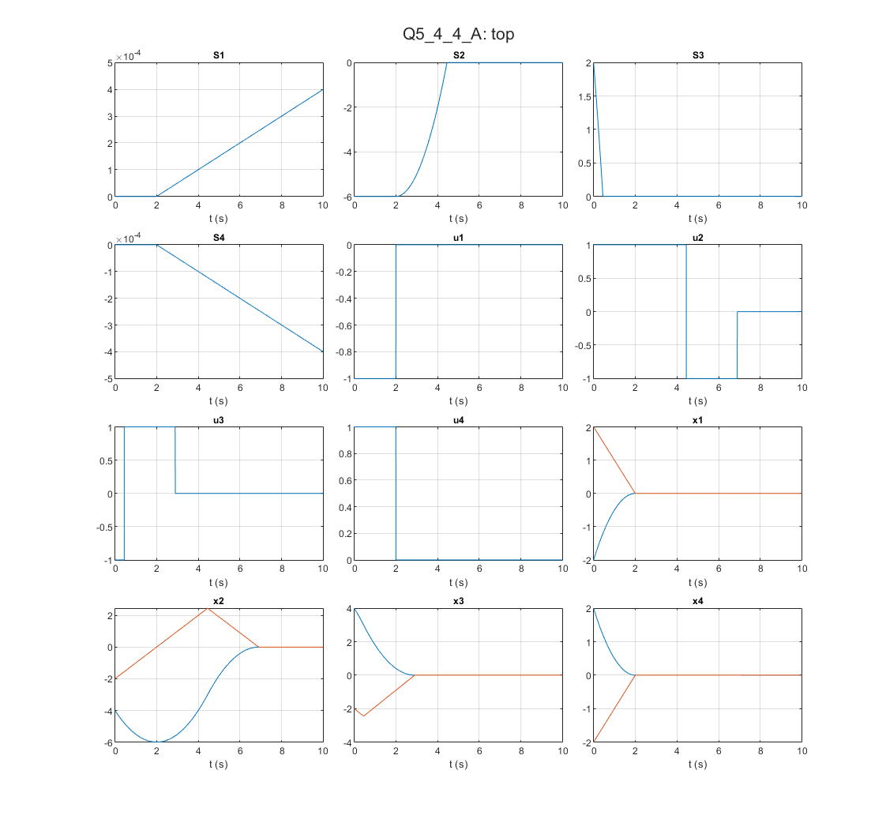

# Optimal Control: Minimum-time bang-bang control versus state feedback

Kirk example 5.4-4: bang-bang control from Pontryagin's principle for four initial states, against a pole-placement state feedback with poles at -1 +/- j.

## Files

- [`report_en.pdf`](report_en.pdf): English summary (LaTeX source next to it)
- `Q5_4_4_A.slx`
- `Q5_4_4_B.slx`
- `figures/`: plots regenerated by re-running the code in MATLAB R2023b

## How to run

Run `Q5_4_4_A.slx` and `Q5_4_4_B.slx`.
