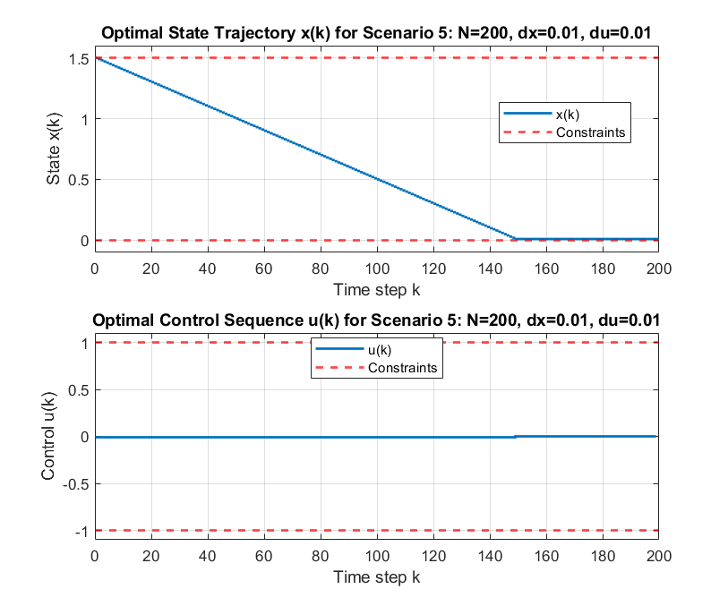

# Optimal Control: Dynamic programming on a grid

Backward dynamic programming for a scalar system with state and input bounds, for three horizons and two grid resolutions.

## Files

- [`report_en.pdf`](report_en.pdf): English summary (LaTeX source next to it)
- `Q8.m`
- `figures/`: plots regenerated by re-running the code in MATLAB R2023b

## How to run

Run `Q8.m`.
