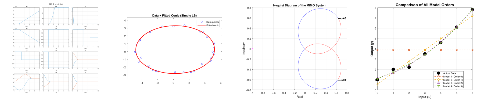

<h1 align="center">MSc-Control-Coursework</h1>

<p align="center">
  My homework, quizzes and simulations from four graduate control courses: Convex Optimization, Optimal Control, Adaptive Control and Multivariable Control.
  <br>
  MSc in Electrical Engineering (Control) at
  <a href="https://www.iust.ac.ir/">Iran University of Science and Technology</a>, 1403–1404 (2024–2025).
</p>

<p align="center">
  
  
  
  
</p>

<p align="center">
  
</p>

<p align="center"><sub>
  Left to right: minimum-time bang-bang control (Optimal Control HW6), a least-squares conic fit (Convex Optimization HW1),
  characteristic loci of a 2×2 plant (Multivariable Control HW7), and polynomial least-squares models (Adaptive Control HW1).
  All re-generated by running the code in this repository.
</sub></p>

---

## What's in here

Each course has one folder, and each assignment has its own folder inside it with:

- `report_en.pdf`: an **English summary in LaTeX** of what the problem asked, what I did and what came out. The `.tex` source sits next to it, and all summaries share [`tex/preamble.tex`](tex/preamble.tex).
- the **MATLAB / Simulink / Python code** I wrote for it, when there was code;
- `figures/`: plots **re-generated by running that code** in MATLAB R2023b for this repository.
- a short `README.md`.

The problem statements, textbooks, slides and papers belong to their authors and are not included. Each README describes the problem in my own words instead.

## Courses

| Course | Term | Assignments | Highlights |
|---|---|---|---|
| [**Convex Optimization**](Convex-Optimization/) | Spring 1404 (2025) | HW1–5, comprehensive HW, exercises, 2 quizzes | LP/QP/SOCP/SDP reformulations, LMIs for dissipativity and H∞ design, a mixed-integer set-point problem, UAV path planning by successive QPs |
| [**Optimal Control**](Optimal-Control/) | Spring 1404 (2025) | HW1–8 | Calculus of variations, Pontryagin's principle, finite-horizon LQR and tracking in Simulink, minimum-time bang-bang control, dynamic programming |
| [**Adaptive Control**](Adaptive-Control/) | Autumn 1404 (2025) | HW1–7 | Least squares and RLS, self-tuning regulators, MIT-rule and Lyapunov MRAS, MRAC of an unstable plant, nonlinear-valve compensation (Åström & Wittenmark) |
| [**Multivariable Control**](Multivariable-Control/) | Autumn 1403 (2024) | HW1–4, HW6–8, take-home | RGA and decoupling of a distillation column, Rosenbrock/MFD representations, controllability indices, characteristic-locus design |

The [Nonlinear Control homework](https://github.com/Arshiagosh/Non-Linear-Control-CourseProject) from the same degree is in its own repository.

## How to run

**MATLAB R2023b** with Simulink, the Control System, Optimization and Robust Control toolboxes. Open the assignment folder and run the script or model named in its README. Where a model needs gains computed first (Optimal Control HW4 and HW5), the README says which script to run before it.

Extra tools for a few assignments:

- [YALMIP](https://yalmip.github.io/): Convex Optimization HW4 `Q10.m`, HW5 and Quiz 4. The SDPs use `lmilab` from the Robust Control Toolbox.
- [CVX](https://cvxr.com/cvx/): Convex Optimization comprehensive HW `Q4.m`.
- Python 3 with the packages in [`requirements.txt`](requirements.txt): Convex Optimization HW4 `Q8.py`, `Q9.py`.

```bash
pip install -r requirements.txt
```

## What I found when re-running the code

I re-ran everything for this repository. All 16 Simulink models and most scripts run as submitted and gave the figures in `figures/`. Where code did not run or gave a different result, I left it as I submitted it and wrote down what happened:

| Where | What happens |
|---|---|
| Convex Optimization HW5 `Q8.m` | Syntax error: a missing `)` on the last line |
| Convex Optimization HW5 `Q9.m` | Uses strict LMI inequalities, which current YALMIP rejects |
| Convex Optimization comprehensive HW `Q3.m` | `quadprog` reports the linearised QP infeasible at each iteration, so the path stays on the initial straight line |
| Multivariable Control take-home | Both scripts run, but the closed loops they build are unstable (largest pole real part +0.34 and +44.1) |
| Convex Optimization HW4 `Q8.py`, `Q9.py`; comprehensive HW `Q4.m` | Not re-run: CVXPY and CVX could not be installed on the machine used here |

## Repository layout

```
MSc-Control-Coursework/
├── Convex-Optimization/     HW1–HW5, Comprehensive-HW, Exercises, Quiz3, Quiz4
├── Optimal-Control/         HW1–HW8
├── Adaptive-Control/        HW1–HW7
├── Multivariable-Control/   HW1–HW4, HW6–HW8, TakeHome
│   └── <assignment>/        README.md, report_en.tex/.pdf, code, figures/
├── tex/preamble.tex         shared LaTeX preamble for the English summaries
├── docs/banner.png
├── requirements.txt
└── LICENSE
```

## Author

**Arshia Goshtasbi**: [github.com/Arshiagosh](https://github.com/Arshiagosh)

The code and the English summaries are released under the [MIT License](LICENSE).
